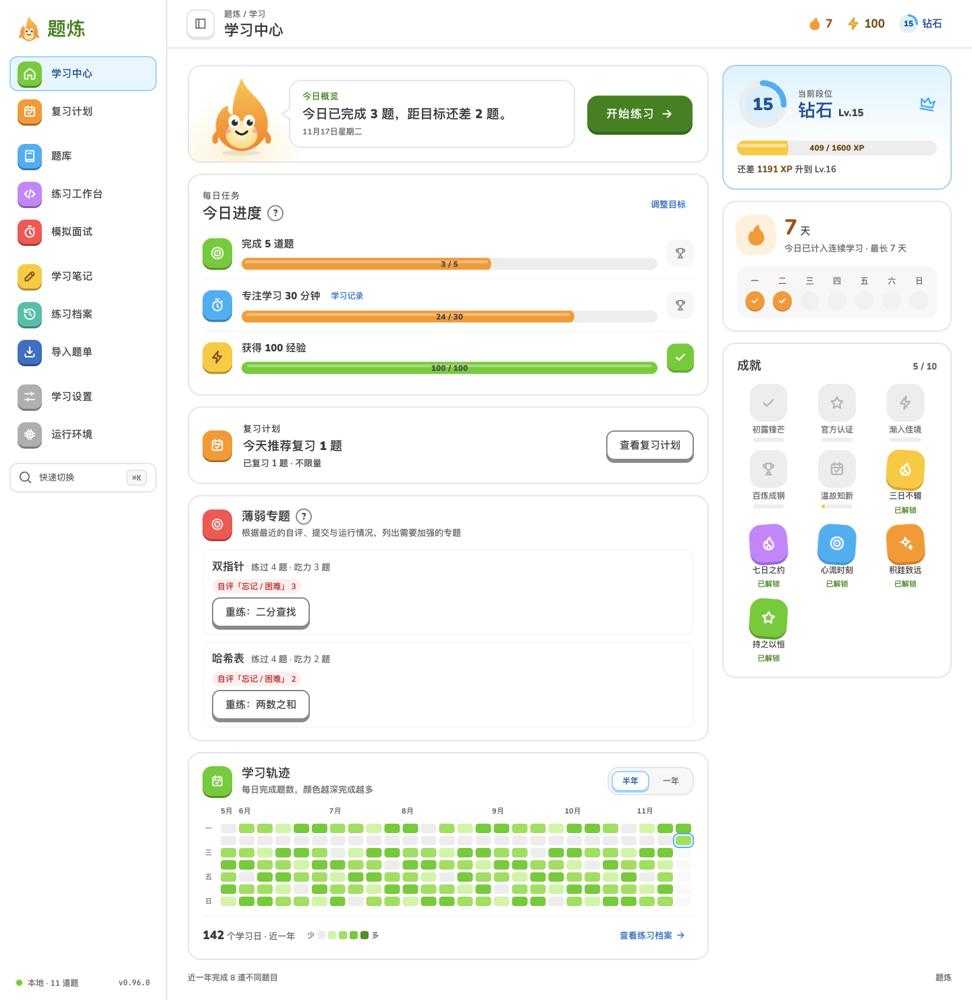
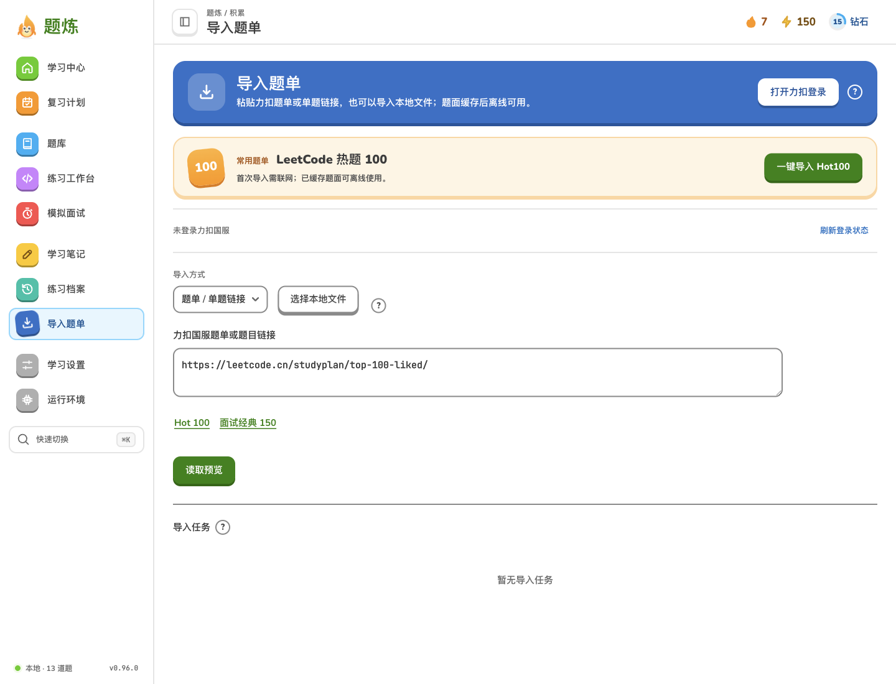
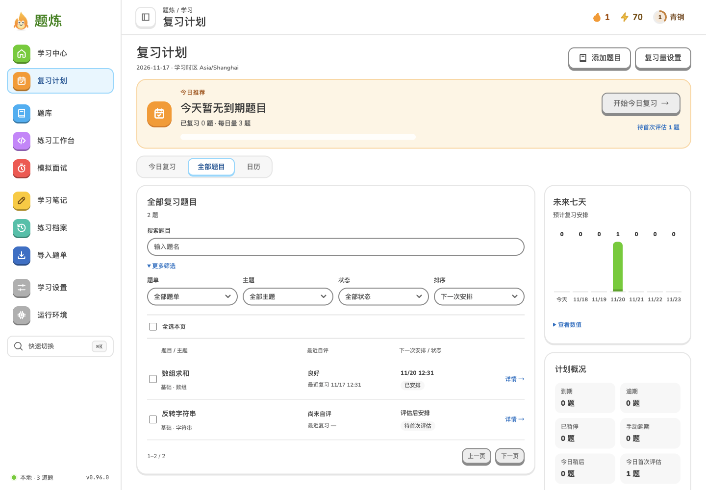
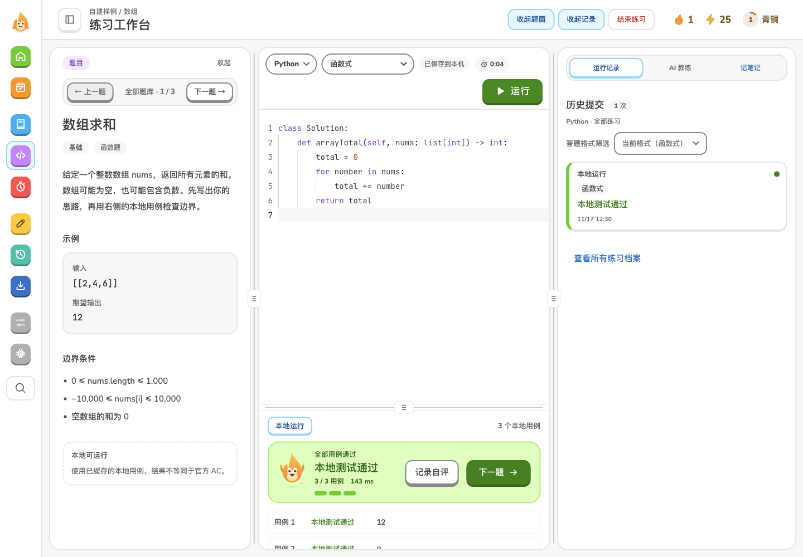
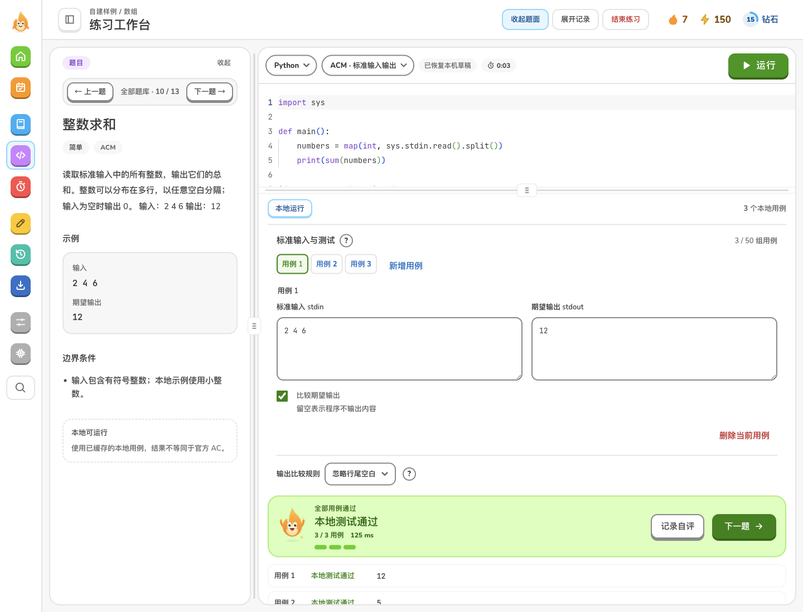
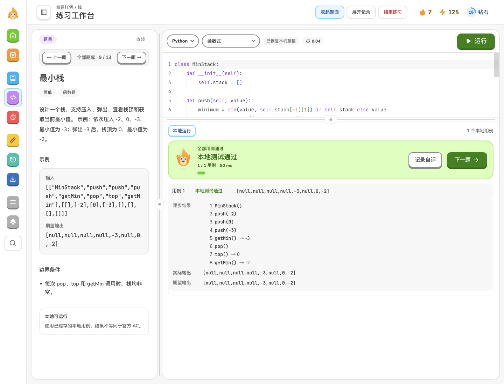
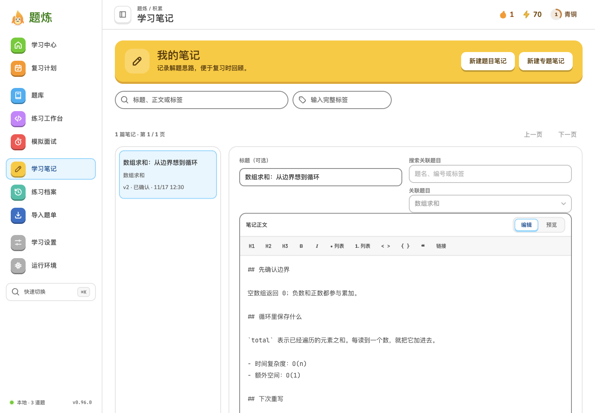
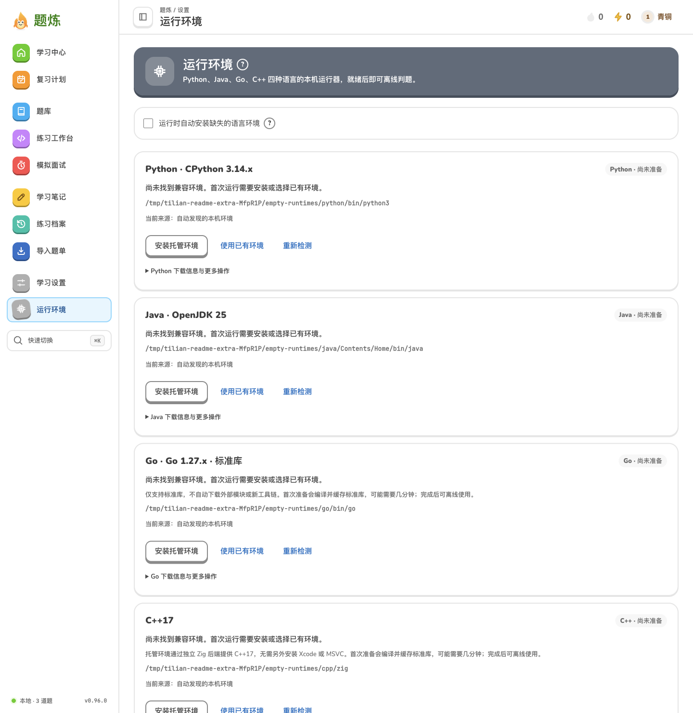
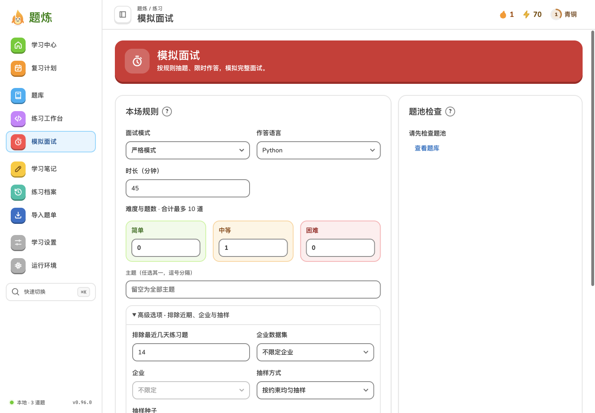

<div align="center">

# 题炼

**把做过的题，变成下次还会的题。**

为校招和算法面试，把刷题、复盘与复习放进一个本地工作台。

支持 **Python / Java / Go / C++17**，覆盖函数题与 ACM 输入输出练习。

[下载 v0.98.0](https://github.com/xhuandy666/AlgoPractice/releases/tag/v0.98.0) · [快速开始](#三步开始练习) · [更新记录](CHANGELOG.md) · [反馈问题](https://github.com/xhuandy666/AlgoPractice/issues)

</div>

**已有力扣，也可以多一个整理学习过程的地方。** 继续用力扣获取题目、完成官方判题；题炼把练习 → 诊断 → 笔记 → 复习 → 模拟面试串起来，让你回看哪里卡住、安排下次重练，再用限时训练检验掌握情况。

## 为什么不只用力扣？

题炼不是要替代力扣。它适合想把练习节奏、AI 服务和学习积累更多掌握在自己手里的同学：

| 你想解决的问题 | 题炼提供的选择 |
| --- | --- |
| **按自己的需要使用 AI** | 本地练习、复习和自建模拟面试无需额外题炼订阅。AI 可选，自带 Key，是否启用、选哪家服务由你决定；费用按服务商规则计算。 |
| **给自己安排一场限时训练** | 可限定一张已导入题单，按题数、难度和时长抽题，也可按企业数据筛选。严格模式独立作答，辅导模式按需求助，结束后回看当时的代码与结果。 |
| **知道今天该复习哪几题** | 按掌握程度自评，生成题目级安排和每日推荐量；支持延期、暂停、补评与评分更正，不只记录“做过”。 |
| **从函数题练到笔试输入输出** | 普通练习可自由切换函数式 / ACM，用完整 stdin / stdout 程序练习；四种语言及两种格式分别保存草稿。 |
| **把复盘留在同一个地方** | 代码、运行与官方提交记录、题目笔记和复习历史放在同一个工作台。本机保存、完整备份，无需注册题炼账号。 |



*以下截图保留 v0.96.0 的真实应用界面，使用隔离样例数据；运行结果来自自建用例的本地执行，学习历史为演示数据，不代表真实账号的官方判题结果。v0.98.0 新增的自测输入、深色外观等功能见下方文字说明。*

## v0.98.0 新增与改进

| 模块 | 可以做什么 |
| --- | --- |
| **接着上次练习** | 记住题目、语言与题单，首页直接继续未解出的题或进入题单下一题；读取暂时失败时保留记忆并提供重试。 |
| **更短的复习流程** | 首页开始或继续本轮复习，自评后自动进入下一题；可只读对照以前通过的代码与笔记，结束摘要按实际新增自评统计。 |
| **自测输入与失败反馈** | 函数题可自行输入一组参数查看输出；结果绑定当时的输入，正常退出前保存输入。普通运行自动展开首个未通过用例。 |
| **按题单模拟面试** | 从指定题单组卷，缺题时解释原因，不用其他题单补足；仅打开读过的题不会因此被近期练习规则排除。 |
| **成长详情与新手任务** | 查看完整段位阶梯、经验来源和成就进度；先跑通自带样例，再导入题单，三步全部完成后收起新手引导。 |
| **外观与阅读偏好** | 浅色、深色或跟随系统；代码字号可调。专题标签默认隐藏，需要时再展开，避免提前提示解法方向。 |
| **AI 对话空间** | 输入区随内容增高，把更多空间留给对话；笔记草稿和官方自动分析放入“更多操作”，请求中可直接停止。 |

各模块的完整变化与修复见 [更新记录](CHANGELOG.md)。应用内检查和下载更新自 v0.96.0 起提供，仍由你确认安装时机。

## 少一些准备，直接开始练习

在题库点击 **“一键导入 Hot100”**，即可读取[力扣官方热题 100](https://leetcode.cn/studyplan/top-100-liked/)并逐题缓存，不用再寻找和粘贴题单链接。支持暂停、继续和失败重试；已有同源题单直接复用，用户移出的题目不会因重启或继续任务被重新加入。



首次导入需要联网，已缓存内容可离线阅读。应用不携带完整 Hot100 题面，不下载隐藏测试集，也不绕过登录、会员权限或站点验证。

## 打开学习中心，看到自己的进步

每日目标、已完成题数、有效学习时长和连续学习天数集中展示。半年 / 一年热力图记录每天完成的题目，点击日期即可进入当天的练习档案，回看代码、运行结果和学习过程。

首页可以直接继续上次尚未解出的题，或进入正在练习的题单里尚未打开的下一题；重新启动后仍保留题单来源和上次语言。新手可先从“运行一次代码”打开自带的数组求和样例，解出后再导入自己的题单。三步没有全部完成时，剩余入口会继续保留。

学习中心同时展示经验、等级、段位、连续学习与成就徽章。经验由代码运行、解题、复习和有效学习时长等记录汇总，各类来源设有每日上限；复习自评每天最多 10 次计入经验。首次解题、累计复习和连续学习等里程碑会解锁对应成就。

点击段位卡、“经验明细”或成就徽章可打开**成长详情**，查看完整段位阶梯、今天各来源的经验与上限，以及每枚成就的条件、进度和下一步操作。

学习中心还会列出最该补的**薄弱专题**：根据每道练过的题当前的状态（最近自评为「忘记 / 困难」，或尚未解出且官方提交、本地运行多次失败、多次求助 AI）按标签汇总，给出可以重练的题和同专题里还没练过的新题。至少练过 2 道题且有吃力迹象的专题才会显示；只是没解出、也没有吃力迹象的题不计入。重练在单独的草稿里从模板重写，不覆盖原来的练习草稿；没写完的重练下次接着继续，写完可以直接记录自评、更新复习安排。

完成题数按题去重：当天解出的题（题目自带的用例全部通过，或力扣官方 AC）自动计入；本地判断不了对错的题，最终代码运行过（或提交到力扣）再点“结束练习”才计入；结束时最后一次运行或官方提交没有通过、或最终代码没有运行或提交过的，不计入。只能看题面、不能本地运行的题，提交到力扣后才计入。同一道题重复练习只计一题。学习时长仅在练习工作台处于前台且近期有操作时累计，长时间闲置和系统睡眠不计入。

**复习以题目为单位**，思路回忆、Python / Java / Go / C++ 重做共用一份计划。在“复习计划”添加题目，完成首次自评后生成后续安排；可以按今日推荐开始，也可以主动回忆或重做后记录自评。计划支持每日推荐量、延期、暂停、评分历史与更正，日历可查看各日安排。

首页的复习摘要可直接开始今日推荐或继续本轮复习。工作台点击“自评并下一题”，保存评分后自动推进；今天已评过的题直接进入下一题，最后一题可完成本轮。结束摘要分别显示本轮新增自评、显式跳过和未新增自评的数量，不把暂停或延期后越过的题算成已经复习。

想用几分钟回忆思路，可先独立回忆或重写，再点**“对照上次的解法”**，只读查看以前通过的代码和自己的笔记。优先使用当前语言；同一语言里优先官方 AC，再选本地通过记录，没有时再查其他语言。查找会继续翻页，不会因为最近 50 条都未通过就漏掉更早的解法。对照不会改写当前复习草稿。



普通练习中解出一道题（力扣官方 AC，或题目自带的用例在本地全部通过）后，题目会加入复习计划。当天尚未自评时：官方 AC 会在前台工作台直接提示自评，选择“稍后再评”后可从复习计划的“待补自评”补填；本地通过常常只是提交前的一步，所以只在测试结果旁显示“记录自评”，不打断练习，不评也会留在复习计划里等待自评。ACM 模式下用自己填写的期望输出跑通，不算解出。

官方 AC 后立即计入今日完成，判题结果下方会提示“结束本题练习”，点一下即可归档这次作答。AI 正在分析这道题时，按钮会等分析完成后再启用，以免中断分析。

## 写代码、运行、回看，留在同一个工作台

题面、代码编辑器、测试结果与练习记录并排展示。每次运行保留当时的代码和结果，结束练习后可回看完整档案，也能从历史代码恢复一份新草稿。

普通运行会自动展开首个未通过的用例，集中显示输入、实际输出、期望输出和打印内容。函数题还可以点**“自测输入”**，按参数顺序每行写一个值，只运行这一组并查看输出；它不判对错，不写入提交历史，也不影响解题统计或经验。结果保留当时提交的输入，修改代码或输入后会明确标记旧结果。自测输入按题目在本机保留最近 60 道题，每份最多 8,000 字符；收起面板、切题和正常退出前都会保存。设计题暂不提供此入口，ACM 可直接编辑自己的用例。

上次工作台读取暂时失败时，题目、语言、题单和草稿会保留，可点“重新读取工作台”或从题库重新打开同题。只有确认题目已不存在时才回到自带样例。



编辑器默认不自动弹出补全，更接近面试时手写代码；需要时按 Ctrl+Space（macOS 为 Control+空格）唤出基于当前代码词汇的补全，也可以在“学习设置”里改为输入时自动弹出。严格面试中补全完全关闭。

在“学习设置”可选择浅色、深色或跟随系统，默认浅色；代码字号可选 12–20 像素，默认 14，普通练习和模拟面试都会使用。外观、字号及补全偏好只在本机保存。题库、复习列表和工作台顶部默认隐藏专题标签，需要时可开启“显示专题”或展开题面底部的“相关专题”。

代码区上方显示本次练习的有效用时，和学习统计用同一套规则：窗口在前台、最近 5 分钟内有操作时才计时，离开或闲置会自动暂停。

在工作台直接打开题目笔记，边练习边记录思路，草稿自动保存。提交历史同时收录本地运行和官方提交，可只读回看代码、比较差异，并给记录添加备注；历史代码不会因回看而被覆盖。

进入练习时，导航自动收为紧凑侧栏，也可手动展开或收起。工作台的三个分隔条支持拖拽，聚焦后可用方向键调整；需要时可重置布局。

“上一题 / 下一题”沿进入时的题单或复习来源顺序浏览，顺序在进入时固定，不会因后续筛选改变。也可使用 `Alt + ← / →`，编辑器和输入框内不触发切题。浏览相邻题目不会推进复习队列；本轮复习仍需通过“自评并下一题”“下一题”或“跳过本题”确认进度。

普通练习可自由选择 **函数式 / ACM**。四种语言的两种格式分别保存代码；ACM 支持多组标准输入、可选期望输出和比较规则。切换格式不会覆盖另一份草稿；没有填写期望输出时，结果只表示“运行完成”，不会冒充“通过”。



力扣函数题大多没有可信的期望输出，本地运行会把每个用例的输出与题面示例比对，标出“示例一致 / 顺序不同 / 示例不同”。这只是参考：答案不唯一或允许任意顺序的题，与示例不同也可能是对的；是否通过以力扣官方提交为准。

“移动零”“轮转数组”“颜色分类”这类原地修改数组、没有返回值的题，会在运行后读取被修改的参数作为输出，也能本地运行和示例比对。更新前已导入的这类题，可在题库选中题单后点“刷新只读题”批量更新：逐题重新读取题面，只保存刷新后能本地运行的题，进行中和历史的练习不受影响。

“LRU 缓存”“最小栈”“实现 Trie”“数据流的中位数”这类**设计题**也能本地运行：按题目给出的操作序列创建对象、依次调用方法，逐步显示每次调用当时的返回值（构造和无返回值的方法记为 `null`），后续操作不会改写前一步的数组或链表输出。Hot100 中这四道题按题面示例判定是否通过；其他设计题只展示输出并与题面示例比对，含随机结果的方法（如 `getRandom`）与示例不同也可能是对的。更新前已导入的设计题同样可以用“刷新只读题”更新。

分步结果按操作顺序展示调用，并标出第一处与期望或题面示例不同的位置，便于检查是哪次操作改变了状态。



登录力扣国服后，在工作台点击 **“提交到力扣”**，即可提交当前 Python / Java / Go / C++ 函数题代码，在题炼查看官方判题结果、返回的通过用例数及错误信息。每次提交保存代码快照，也能在练习档案中回看。

本地运行和官方判题分别显示。题炼不下载隐藏测试集；官方返回多少信息，就展示多少。遇到登录过期或站点验证时，在独立登录窗口处理后再继续；已有提交编号的中断查询可以恢复，不会自动重复提交代码。

## AI 教练，围绕你的作答提供帮助

点击 **“获取提示”** 获取下一步线索，或点击 **“检查代码”** 分析当前作答。AI 会结合题面、代码和对应的编译、运行或官方判题结果，解释问题并建议修改；代码通过后，也可以复盘思路和复杂度。

普通练习连续 3 次代码运行未通过时，会提示打开 AI 教练，是否发起请求仍由你决定。

输入框是可选的。想只要提示、解释某段代码，或查看完整解法，写下需求即可。输入区从一行随内容增高，最多四行，请求中发送按钮会变为“停止”。代码建议仍需你预览差异后应用；练习结束前，可从“更多操作”（⋯）让 AI 整理笔记草稿，由你确认保存。

在 AI 面板的“更多操作”，或“学习设置 → AI 接口 → 教练行为”开启**官方提交后自动分析**，仅在力扣官方提交完成时分析该次提交反馈，本地运行不会自动触发。开关旁的问号可悬停或聚焦查看说明。

回答中的运行和提交引用必须来自该次可核对的记录，官方反馈对应提交时的代码快照。格式或引用校验失败时，系统会自动尝试修复一次；仍无法核对的回答会显示具体原因，可重试或反馈。

支持 **DeepSeek、GLM、Qwen 和自定义 OpenAI 兼容接口**，使用自己的 API Key。AI 是可选项，不配置也能使用本地练习、笔记和复习。服务商按其规则收费，题炼不保证比会员方案更便宜，也不承诺 AI 永久免费。每条回答旁会显示服务商报告的 Token 数；“学习设置”的 AI 接口里可以查看今天、本月和累计的提问次数、调用次数与 Token 用量，其中包括对话摘要、格式修复等额外调用。题炼只汇总服务商返回的数字，不估算，也不换算成费用。

## 整理自己的题库，离线继续练

导入力扣国服题单、收藏、题目链接，或用 CSV / JSON 添加自己的练习。题面、图片和运行环境准备好后，断网也能写代码、运行、记笔记和复习。

题库可以按练习进度筛选（未练过 / 练过 / 已解出 / 今日待复习），每道题旁标出“已解出”“练过”“待复习”；Hot100 卡片和题单选择里会显示“已解出 x / 总数”。已解出指题目自带的用例在本地全部通过，或力扣官方 AC；ACM 模式下自己填写的期望输出只用于自测，不算解出。

“清除筛选”或空列表里的“查看全部题目”会清除全部条件。切换题单或练习进度时，点击仍在显示的题目会保留它原来的题单和题序，不会记成刚选的新题单。

题库、练习档案、笔记、复习记录和附件可一起备份，迁移电脑时恢复即可。四种语言环境支持应用内安装和离线包安装。

题目笔记与专题笔记支持 Markdown 编辑、附件和版本确认。未确认的内容先保存为草稿，确认后保留版本；回看或继续编辑旧版本时，不会直接改写原记录。



点击运行时，题炼先检测本机兼容环境。缺少环境时，可选择 **安装并运行**、已有环境或离线包；仅准备当前需要的语言，不修改系统 PATH。语言工具链不随应用安装包打包，“按需自动安装”默认关闭，由你决定是否开启。



## 按面试节奏，做一场限时训练

用自己已导入的题目或企业题单，选择题数、难度与时长，按需抽题并计时作答。**严格模式**限制 AI、旧答案和笔记等帮助入口，适合检验独立解题；**辅导模式**适合边练边学。结束后回看当时的作答记录，再将需要巩固的题添加到题目级复习计划；也可以一键把冻结代码没有本地通过的题全部加入。

可在“题目范围”选择一张已导入题单，只从其中抽题；题量不足时不会从其他题单补齐。题池检查显示未缓存数量，并按原因列出未入选的题名；只打开读过、没有运行或提交的题不会因此被视为近期练习。因排除近期练过的题而缺题时，可一键包含它们重新检查。导入入口支持力扣国服题单链接、批量链接、CSV / JSON；需要按企业或频率抽题时，再导入企业数据。



自建模拟训练不需要额外题炼订阅，但不附赠或解锁力扣会员题库、企业模拟面试等站点权益；题源访问仍遵循你的账号权限。

## 四语言支持与适配边界

当前版本提供 Python、Java、Go、C++ 四种语言。普通练习的每种语言 × 函数式 / ACM 分别保存草稿、用例和档案；官方函数题提交、AI 教练及严格 / 辅导面试接入同一语言身份。复习仍按题目共用一份计划，不生成四套重复复习卡。

Go 使用官方 1.27.x 工具链，仅支持标准库，不自动下载外部模块、切换 Go 工具链或启用 CGO。函数题使用顶层函数和显式 imports；完整 ACM 程序使用 `package main`。字符串保留 UTF-8，字符棋盘的 `char` 映射为 ASCII `byte`；需要处理中文字符时使用 `rune`，不可逐字节反转。

C++ 使用独立 Zig 0.16 后端与 C++17，不要求另装 Xcode / MSVC；也可选择经过真实编译、链接和运行探测的完整 clang++ / g++ 环境。函数题保留 `class Solution`；ACM 使用自己的 `main`。`bits/stdc++.h` 是项目独立编写的标准头便利入口，不提供 GCC 专有库、GNU 扩展或第三方依赖。Zig 默认调试检查和标准库与官方判题环境不完全相同，本地结果不能替代官方判题。

`int64` 始终以十进制字符串跨 JS / IPC 传输，避免精度丢失。Go 函数题支持 `math/big.Int`；C++ 函数题暂不支持 `bigint`，会明确提示，可改用自行定义输入输出的 ACM 程序。`ListNode` / `TreeNode`、嵌套数组、原地修改和有效区间观测使用明确的类型适配；不是任意交互、设计题都能本地运行。

四种环境独立安装，原始归档的版本、来源、大小和 SHA-256 固定在 [runtime-manifest.json](runtime-manifest.json)。Go / C++ 安装最后会在正式路径编译并缓存标准库，首次可能需要几分钟；预热未完成时取消或中断会回滚旧安装，已完成预热提交则保留新环境并安全收尾。预热使用独立预算，不扩大用户代码的编译、运行或输出上限。工具链及缓存不随应用打包，也不进入学习备份。

旧题库不会自动联网或替换历史快照。在题库点击 **“补全语言模板”**，预览后保存为新版本；内置演示的补全不联网。个人草稿与进行中的旧练习仍使用原版本，新语言练习从新版本开始。缺模板、输入用例或可支持签名时只能读题与记录代码，不能冒充完整本地适配。

**从 v0.91.0 或更早版本升级到 v0.96.0 及之后版本时，需要重新设置。** v0.96.0 开始使用独立的 `TiLian` 数据文件夹，首次打开从空白开始，不迁移旧版数据库或 `.algobak` 备份。旧版数据库、备份、备份副本和语言环境保留在原来的 `AlgoPractice` 文件夹，可继续用旧版查看；新版本需重新准备语言环境、AI Key 和力扣登录。从 v0.96.0 升级到 v0.98.0 沿用 `TiLian` 数据目录。

验收使用隔离数据库、自建代码和本地服务夹具，不自动向你的力扣账号提交，也不调用真实 AI Key。这些检查不等于真实账号的官方判题或真实 AI 服务验收。

## 下载

**v0.98.0** · 新增自测输入、按题单模拟面试、成长详情、深色外观与代码字号设置，缩短复习与继续练习的操作，并修复保存、恢复和统计问题。完整版本说明与全部附件见 [v0.98.0 Release](https://github.com/xhuandy666/AlgoPractice/releases/tag/v0.98.0)。

直接下载安装包，无需安装 Node.js 或下载源码，按自己的系统和架构选择：

| 你的电脑 | 安装包 | 便携归档 |
| --- | --- | --- |
| Mac · Apple Silicon（M 系列） | [DMG · mac-arm64](https://github.com/xhuandy666/AlgoPractice/releases/download/v0.98.0/AlgoPractice-0.98.0-mac-arm64.dmg) | [ZIP · mac-arm64](https://github.com/xhuandy666/AlgoPractice/releases/download/v0.98.0/AlgoPractice-0.98.0-mac-arm64.zip) |
| Mac · Intel | [DMG · mac-x64](https://github.com/xhuandy666/AlgoPractice/releases/download/v0.98.0/AlgoPractice-0.98.0-mac-x64.dmg) | [ZIP · mac-x64](https://github.com/xhuandy666/AlgoPractice/releases/download/v0.98.0/AlgoPractice-0.98.0-mac-x64.zip) |
| Windows · x64 | [EXE 安装程序 · win-x64](https://github.com/xhuandy666/AlgoPractice/releases/download/v0.98.0/AlgoPractice-0.98.0-win-x64.exe) | [ZIP · win-x64](https://github.com/xhuandy666/AlgoPractice/releases/download/v0.98.0/AlgoPractice-0.98.0-win-x64.zip) |

Mac 需要 **macOS 14 或更新版本**；Windows 需要 **Windows 10 / 11 x64**。Linux 与 Windows ARM 暂不提供安装包。版本说明见 [v0.98.0 发行页](https://github.com/xhuandy666/AlgoPractice/releases/tag/v0.98.0)，旧版本保留在 [发行历史](https://github.com/xhuandy666/AlgoPractice/releases)。

**已安装 v0.91.0 或更早版本的用户，首次使用自动更新功能仍需手动安装 v0.96.0 或更新版本，可直接安装本页的 v0.98.0。** 旧版不会自行获得新版本的更新能力；升级前请阅读上方的数据兼容说明。

应用目前没有正式开发者签名，也未完成 Apple 公证。Mac 首次打开可能显示“Apple could not verify 题炼 is free of malware”。请从本仓库 Release 下载，并按需核对其中的 SHA-256 校验文件。

按照 [Apple 的打开说明](https://support.apple.com/zh-cn/102445)，确认下载来源后：

1. 将“题炼”拖入“应用程序”，尝试打开一次，然后关闭提示。
2. 打开 **系统设置 → 隐私与安全性**，向下找到“安全性”，在“题炼”被阻止的信息旁点击 **仍要打开**。
3. 按系统要求认证，再次确认 **打开**。之后可直接从“应用程序”或 Dock 启动。

Windows 首次打开可能出现 SmartScreen 提示。

## 三步开始练习

1. **加入想练的题。** 在题库点击“一键导入 Hot100”；也可粘贴力扣链接，或导入 [CSV 链接示例](examples/leetcode-links.csv) / [JSON 自建练习](examples/practice.json)。
2. **选择语言和答题格式。** 打开题目，选择 Python / Java / Go / C++ 与函数式 / ACM，开始写代码。旧题缺新语言模板时，在题库显式预览“补全语言模板”；ACM 的标准输入与期望输出由你设置，不自动转换官方用例。
3. **运行并复习。** 用 `⌘ / Ctrl + Enter` 运行。缺少环境时按提示安装，或选择已有兼容环境（CPython 3.14.x、完整 JDK 25、Go 1.27.x 或可实际编译链接 C++17 的环境）。需要官方判题时点击“提交到力扣”；官方 AC 后按提示自评，或在“复习计划”主动添加题目、记录自评，下次按到期安排继续。

想使用 AI，在“学习设置”选择服务、填写自己的 Key 并测试连接即可。

### v0.98.0 使用说明

- 正式发行版默认自动检查并后台下载更新；下载完成后由你选择安装时机，不会自行重启。Mac 打开下载好的 DMG 后仍需手动完成安装；Windows EXE 安装版可选择“重启并更新”。详见下方更新说明。
- 复习按题目维护一份计划。主动自评和当前学习日首次官方 AC 后的自评共用该计划；错过提示可从“待补自评”继续，已记录评分可在历史中更正。
- 进入练习自动收起导航；工作台三个分隔条可拖拽或用键盘调整，也可重置布局。相邻题按钮及 `Alt + ← / →` 使用进入时固定的来源顺序；切题浏览不等于完成本轮复习，输入区域内不触发快捷键。
- AI 教练提供“获取提示”“检查代码”和对话提问。官方自动分析仅由已完成的官方提交触发；回答引用经过核对，校验失败最多自动修复一次，代码修改仍需预览确认。
- 题库和导入页内置 **“一键导入 Hot100”**，无需寻找或粘贴链接。点击后从[力扣官方热题 100](https://leetcode.cn/studyplan/top-100-liked/)读取题单并逐题缓存；可暂停、继续和重试。已有同源题单直接复用，更新成员仍需显式预览确认。
- 点击运行前检测本机兼容环境；缺少环境时原位选择“安装并运行”、已有环境或离线包。只准备需要的语言，四种工具链均不随应用打包；按需自动安装默认关闭。环境准备失败与代码编译失败分开显示。
- 安装期间可以继续编辑。修改代码或输入、切换题目/语言/格式、结束练习或关闭窗口后，旧请求不会自动执行，环境就绪后请重新运行。
- 普通工作台可选择函数式或 ACM，分别保存每种语言的代码与输入。ACM 支持多组 stdin、可选期望输出与精确/归一化比较；没有期望输出时只表示运行完成，不代表通过。自由 ACM 的输入约定和自定义期望不属于力扣官方判题。
- 历史记录保留原格式与测试快照；ACM 不能直接提交到力扣。模拟面试暂保留题目原生格式，不在计时中切换格式。
- 语言环境始终在本机执行，不是文件或网络沙箱。请只运行理解且信任的代码。新设备首次断网且没有环境时只能阅读与编辑，不能执行。
- 在 macOS 上，程序运行时整组进程占用内存超过 1 GiB 会被终止并显示为运行错误，防止失控的代码拖垮整台电脑；这是本机保护，不是力扣的内存限制。Windows 暂未启用此限制。

v0.96.0 与 v0.91.0 及更早版本使用不同的数据文件夹，旧记录可继续用对应旧版查看；旧备份不能导入新数据目录。Hot100 是官方题单导入快捷入口，不是随安装包分发完整题面；首次导入需要联网，未缓存内容不能离线阅读。

<details>
<summary><strong>运行时下载不方便？使用离线安装包</strong></summary>

在 [v0.98.0 的发行附件](https://github.com/xhuandy666/AlgoPractice/releases/tag/v0.98.0) 下载你需要的语言所对应的文件（系统和架构必须匹配）：

| 系统 | Python | Java | Go | C++17（Zig） |
| --- | --- | --- | --- | --- |
| Apple Silicon Mac | [Python](https://github.com/xhuandy666/AlgoPractice/releases/download/v0.98.0/AlgoPractice-runtime-python-darwin-arm64.tar.gz) | [Java](https://github.com/xhuandy666/AlgoPractice/releases/download/v0.98.0/AlgoPractice-runtime-java-darwin-arm64.tar.gz) | [Go](https://github.com/xhuandy666/AlgoPractice/releases/download/v0.98.0/AlgoPractice-runtime-go-darwin-arm64.tar.gz) | [C++17](https://github.com/xhuandy666/AlgoPractice/releases/download/v0.98.0/AlgoPractice-runtime-cpp-darwin-arm64.tar.xz) |
| Intel Mac | [Python](https://github.com/xhuandy666/AlgoPractice/releases/download/v0.98.0/AlgoPractice-runtime-python-darwin-x64.tar.gz) | [Java](https://github.com/xhuandy666/AlgoPractice/releases/download/v0.98.0/AlgoPractice-runtime-java-darwin-x64.tar.gz) | [Go](https://github.com/xhuandy666/AlgoPractice/releases/download/v0.98.0/AlgoPractice-runtime-go-darwin-x64.tar.gz) | [C++17](https://github.com/xhuandy666/AlgoPractice/releases/download/v0.98.0/AlgoPractice-runtime-cpp-darwin-x64.tar.xz) |
| Windows x64 | [Python](https://github.com/xhuandy666/AlgoPractice/releases/download/v0.98.0/AlgoPractice-runtime-python-win32-x64.tar.gz) | [Java](https://github.com/xhuandy666/AlgoPractice/releases/download/v0.98.0/AlgoPractice-runtime-java-win32-x64.zip) | [Go](https://github.com/xhuandy666/AlgoPractice/releases/download/v0.98.0/AlgoPractice-runtime-go-win32-x64.zip) | [C++17](https://github.com/xhuandy666/AlgoPractice/releases/download/v0.98.0/AlgoPractice-runtime-cpp-win32-x64.zip) |

无需解压。在“运行环境”分别选择对应语言的“安装离线包”，应用会校验并安装。请保留下载包原样，重新压缩的归档无法通过校验。

</details>

## 常见问题

**免费吗？需要账号吗？**

题炼以 MIT 协议开源，无需注册题炼账号。本地练习、复习和自建模拟面试不需要额外题炼订阅；AI 服务可选，由你自行配置 Key，费用和可用性由服务商决定，不保证更便宜或永久免费。访问需要登录或会员权限的题源时，仍需使用自己的站点账号。

**我的数据会上传到哪里？**

学习数据默认保存在本机。使用 AI 时，当前请求所需的上下文会发给你配置的服务；来源导入会访问对应站点；应用更新会向 GitHub 查询公开正式版本，并从对应发行附件下载更新包，不发送代码、题目、笔记、学习记录或 Key。点击“提交到力扣”会将当时的代码和语言发送到力扣国服，并在你的力扣账号中留下提交记录。API Key 通过系统加密能力保存，不写入学习备份。

**如何更新应用？**

从 v0.96.0 起，正式发行版默认在启动约 30 秒后检查更新，之后每 6 小时检查一次，只获取 GitHub 上公开的正式发行版。发现更新后在后台下载并校验匹配当前系统和架构的安装包；完成后显示提示，你可以继续练习或选择“稍后”。在“运行环境 → 版本与更新”可以关闭“自动检查并下载新版本”，也可手动检查、下载和重试。已下载的更新仍须手动确认安装。


- **Mac**：当前没有 Apple Developer ID 证书，更新包为对应架构的 DMG。点击“打开安装包”后，题炼保存草稿并退出；按安装窗口提示手动完成替换，再重新打开题炼。不会在后台自行替换应用。
- **Windows EXE 安装版**：点击“重启并更新”后，题炼保存草稿、退出并交给安装程序更新，然后重新启动。
- **Windows ZIP 便携版**：后台下载对应安装包，点击“打开安装包”后保存并退出，再由你完成安装；使用 ZIP 继续保持便携方式时，也可从发行页手动获取新版 ZIP。

应用始终由你决定何时安装或重启。代码正在运行、运行环境正在安装、备份尚未完成或存在活动面试时，请先结束这些操作再安装更新。源码运行不会在后台检查或下载；可以手动查看正式版本，但安装包下载与安装功能仅面向正式发行版。

**能同步到另一台电脑吗？**

当前支持完整备份和恢复，暂不提供自动云同步。在“学习设置”创建 `.algobak`，然后在另一台电脑恢复。也可以在“学习设置 → 备份与恢复”选择一个**备份副本文件夹**（例如云盘同步目录）：每次自动备份后，最新一份会复制过去；已有副本损坏时会重新复制，只保留这台电脑最近 7 份副本，不会删除文件夹里的其他文件；副本包含代码、笔记和附件，放进云盘时会随云盘上传。新电脑需要准备所用语言的运行环境，并重新配置 Key 和站点登录；数据目录可在“运行环境”查看。

**支持哪些题目和用例？**

当前支持 Python / Java / Go / C++17。导入后能否本地运行取决于题目的输入格式、对应语言模板和适配状态；自建 JSON 练习可以提供自己的用例及期望结果。官方提交支持已导入且具备对应语言模板的国服函数题，在普通练习中进行。官方完整测试在力扣执行，题炼通过国服登录会话提交并读取结果，不下载隐藏测试集。该连接使用站点当前的网页接口，可用性取决于力扣接口、账号权限和验证要求。

**输入或切换页面仍有卡顿怎么办？**

在“运行环境 → 性能诊断”开始记录，再重复卡顿时的操作。记录最多持续 90 秒，回到该页可复制报告用于反馈；报告只包含页面类型和耗时，不含代码、题目内容或 Key。

**工作台卡住或意外退出怎么办？**

工作台页面意外退出时会自动重新打开，并提示刚才发生了什么；短时间内反复退出时会暂停自动重新打开，由你选择再试一次或退出。页面长时间没有响应时，可以继续等待、重新打开工作台或停止并退出。代码、笔记和面试作答在输入停顿后很快保存（最长约 2 秒），通常只会丢失退出前几秒的输入；当时正在进行的运行会停止，可以重新运行。如果题炼本身遇到内部错误，会先保存草稿、停止运行和导入任务再退出，并提示可以重新打开；日志只记录错误类型，不含代码、题目或 Key。

**数据文件损坏了怎么办？**

学习数据保存在本机的 SQLite 数据库中。运行中如果 SQLite 报告数据库文件损坏，会提示重新启动；下次启动时会完整检查数据文件。确认损坏时，题炼会找出数据目录 `backups` 文件夹中最近一份通过校验的自动或手动备份，显示备份时间，由你决定是否恢复。恢复前会先把损坏的数据库复制到数据目录下的 `damaged-…` 文件夹保留；本机的提醒设置、AI 设置、附件和登录状态保持不变，这份备份之后的记录会丢失。选择退出则不会恢复或删除任何文件。没有可用备份时，可以继续打开（部分记录可能无法读取），或先复制整个数据目录再处理。

**为什么关掉窗口后还有提醒？**

关闭窗口后应用会驻留菜单栏 / 托盘，可继续发送复习提醒。完全退出后停止提醒；提醒也受系统通知权限与专注模式影响。

## 从源码运行

<details>
<summary>展开开发与构建命令</summary>

准备 Git 和 Node.js **24.17.x**（具体版本见 [.nvmrc](.nvmrc)），在 macOS / Windows 的终端执行：

```sh
git clone https://github.com/xhuandy666/AlgoPractice.git
cd AlgoPractice
npm ci
npm start
```

首次安装依赖需要联网。启动后，可在应用的“运行环境”按需安装四种语言，或选择匹配的原始离线包。

开发检查：

```sh
npm run runtime:install
npm run typecheck
npm test
npm run build
npm run test:desktop
npm run test:learning-center
npm run test:reviews
npm run test:official
npm run test:ai
npm run test:workbench
npm run test:workbench-navigation
npm run test:self-test
npm run test:onboarding
npm run test:acm
npm run test:hot100
npm run test:updates
npm run test:ui
```

测试使用隔离数据目录。`npm run test:ui` 在无界面浏览器中检查 AI 面板、运行环境和 Hot100 等页面，不需要启动 Electron，Linux 上也能运行。`npm run runtime:install` 安装全部四种环境。Go / C++ 真实 Runner 测试需将 `ALGOPRACTICE_NATIVE_TEST_ROOT` 指向该目录；三平台 CI 已设置此变量，缺少任何环境会失败，不会静默跳过。未设置时只运行这些测试的纯逻辑部分。

构建安装包：

```sh
npm run dist:mac
npm run dist:mac:intel
npm run dist:win
```

Mac 安装包请在 macOS 上构建；Windows 安装包建议在 Windows 上构建。产物位于 `release/`。

发布维护：三平台 CI 会校验安装包、平台更新元数据（YAML）和差分校验文件（blockmap）是否与实际产物一致。通过验证后，发行工作流创建草稿；自动更新只读取人工公开后的正式发行版，安装包与对应元数据应一起发布。当前 Mac 没有 Developer ID 签名与公证，使用下载 DMG 后手动安装的方式；配置有效签名与公证后，发行配置可启用 Mac 原生重启更新。

</details>

## 开源与反馈

发现问题或有想法，欢迎 [提交 Issue](https://github.com/xhuandy666/AlgoPractice/issues)。反馈时附上系统、版本和复现步骤；请勿附带 API Key 或私人学习数据。

本项目使用 [MIT License](LICENSE)。应用组件的第三方许可随应用包保留；独立语言工具链遵循各自许可证，其原始许可与声明保留在工具链归档和安装目录中，不意味着工具链随应用打包。
